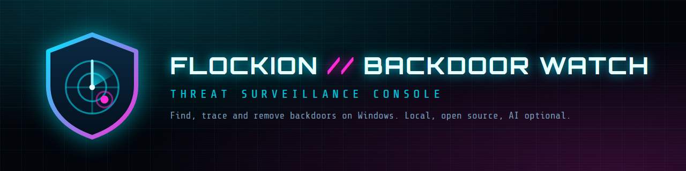
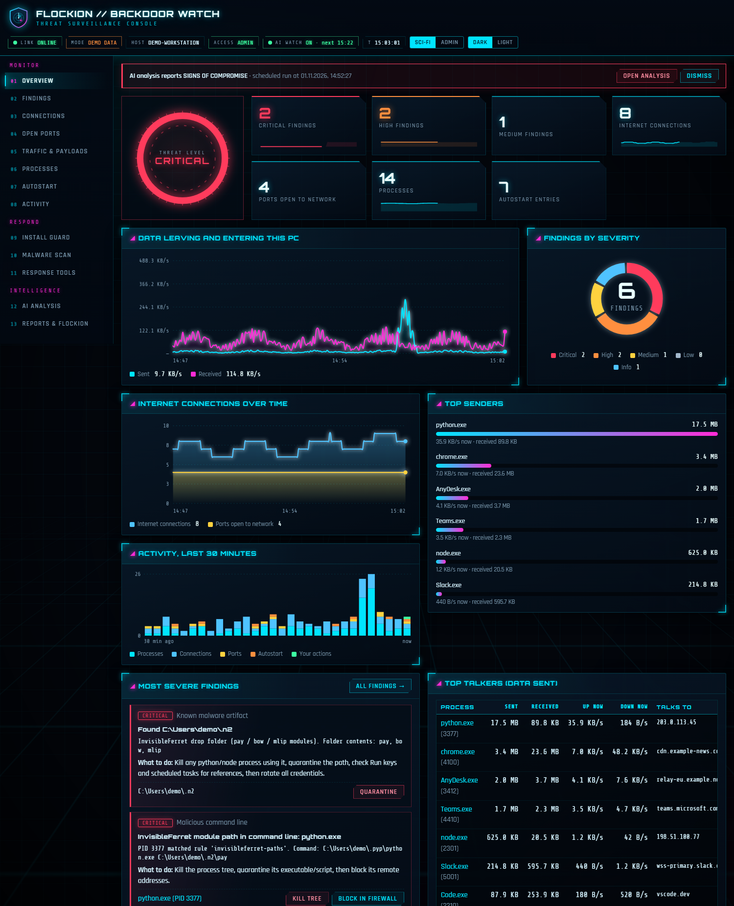
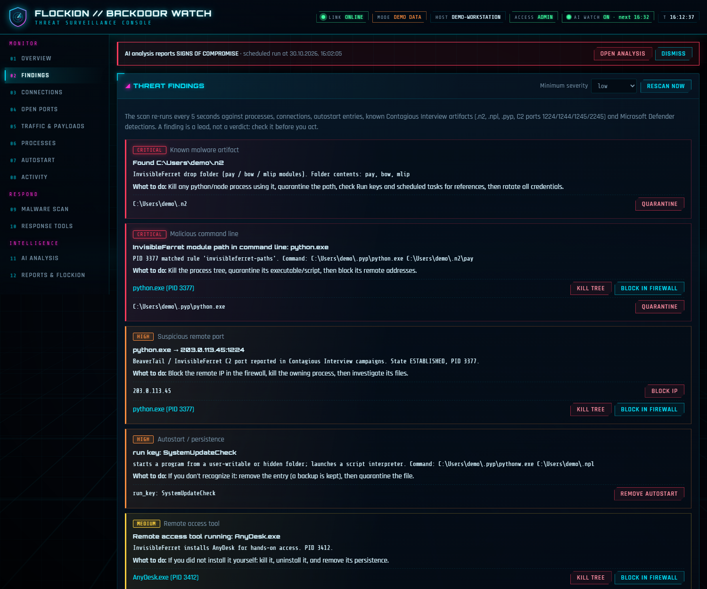
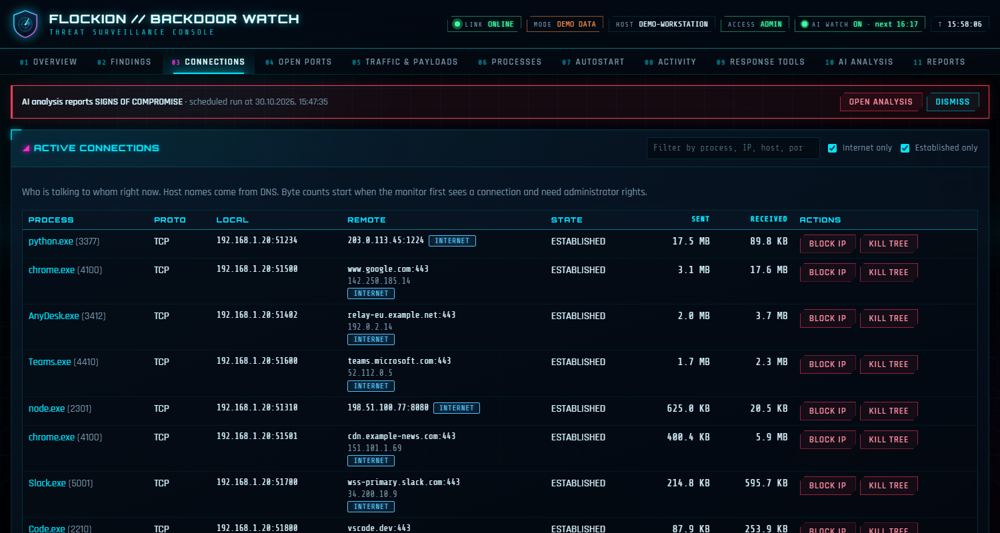
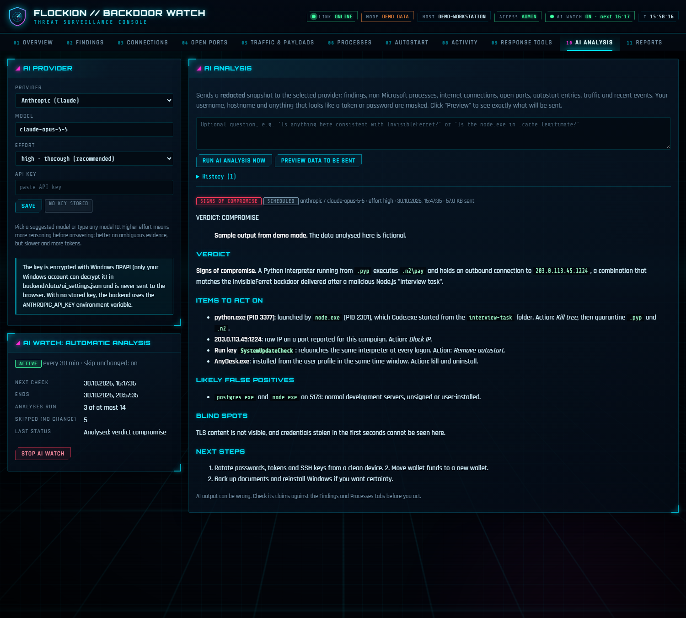
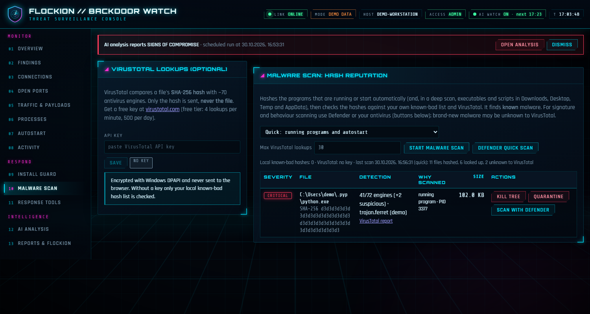
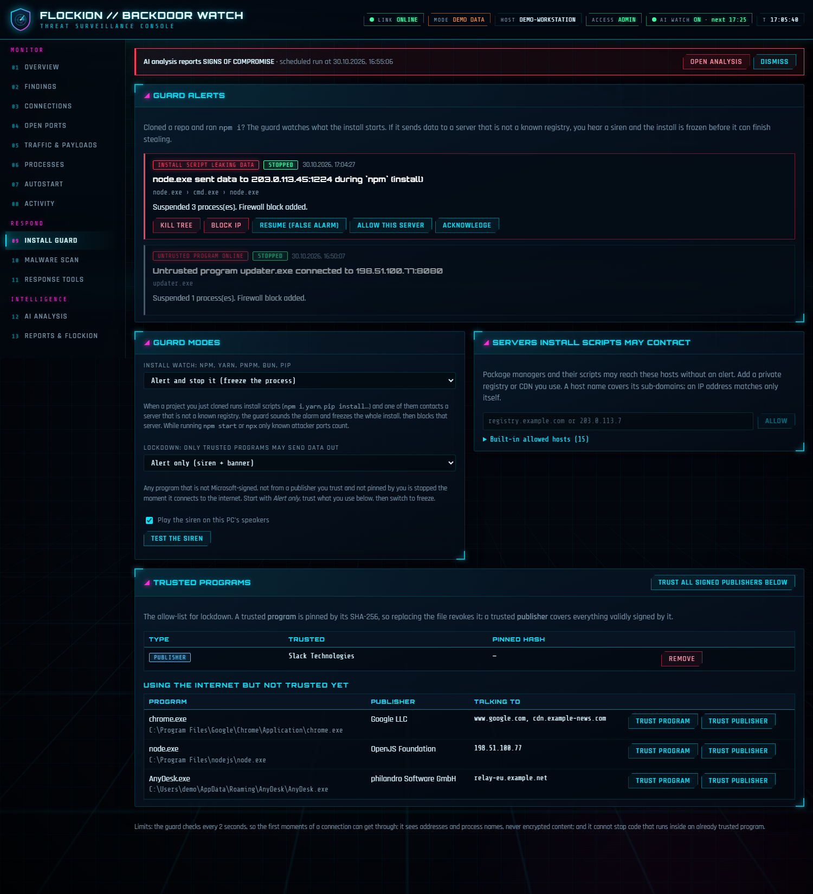
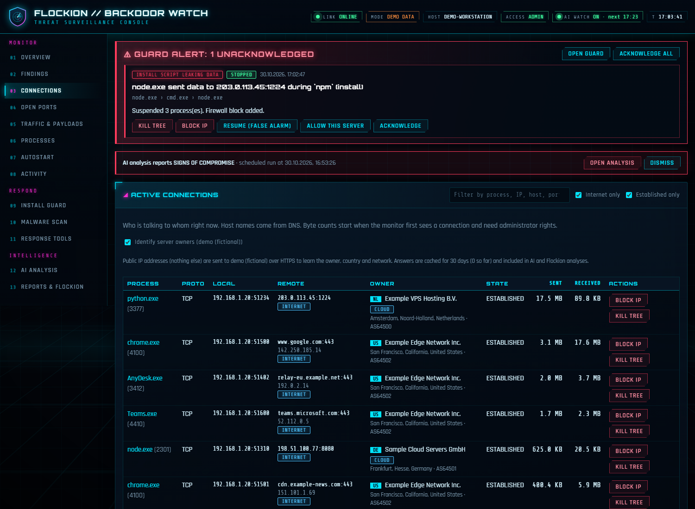
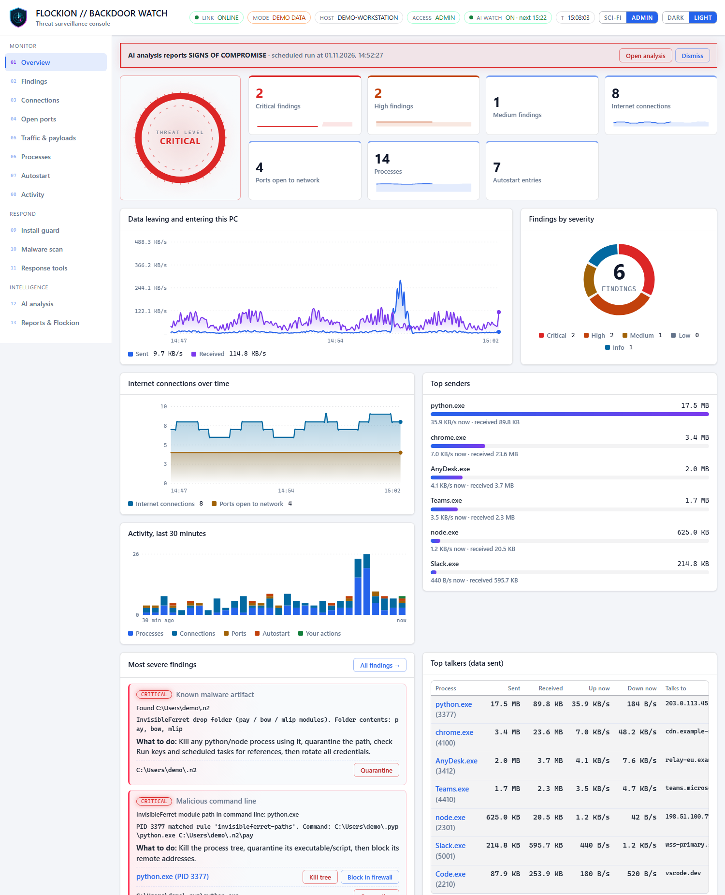
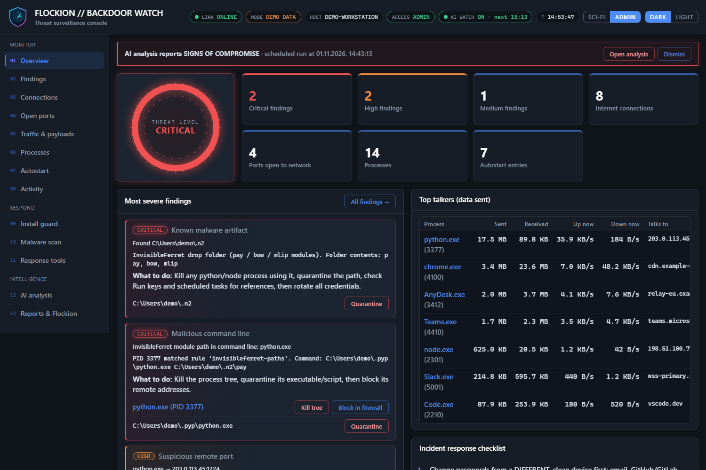

<p align="center">
  
</p>

<p align="center">
  <a href="LICENSE"></a>
  
  
  
</p>

**Flockion Backdoor Watch** is a local Windows dashboard for checking a PC after a suspected compromise. It
shows every process, network connection, open port and autostart entry, explains who started what and which
server it talks to, and gives you buttons to **kill**, **quarantine**, **firewall-block** and **remove** what you
find. It was built after a fake "developer interview" delivered a malicious Node.js project (the DPRK-linked
*Contagious Interview* campaign: BeaverTail, InvisibleFerret, OtterCookie, JADESNOW), and it ships with indicators
for those families. An optional AI analyst (Anthropic or OpenAI) and a [Flockion](https://flockion.com) agent
connector can review the findings for you.

> Defensive tool for **your own machine**. It only inspects the PC it runs on, listens on `127.0.0.1` only, and
> sends nothing anywhere unless you configure AI, report upload or Flockion yourself.

<p align="center">
  
</p>

## Highlights

- **See everything:** processes with signature status and parent chains, every TCP/UDP socket with the owning
  program, remote host names, bytes sent and received, and listening ports reachable from the network.
- **Know what is new:** Run keys, Startup folders, scheduled tasks, services and WMI consumers are tracked, and any
  new autostart entry is reported.
- **Detect known threats:** InvisibleFerret drop folders (`~/.n2`, `.npl`, `.pyp`), reported C2 ports, Microsoft's
  published command-line patterns, loaders in source code, remote-access tools. Rules are plain JSON.
- **Respond safely:** kill process trees, quarantine files (restorable, with SHA-256), block IPs or programs in the
  firewall, remove autostart entries (with backup). Critical Windows processes are protected.
- **Install guard:** clone a repo and run `npm i`? If an install script contacts a server that is not a known
  registry, a **siren** sounds on your PC and the whole install is **frozen** (and the server blocked) before it
  can finish. An optional **lockdown** allow-list does the same to any program you have not trusted.
- **Malware scan:** hashes running and autostart programs (and optionally files in Downloads, Desktop, Temp) and
  checks them against your own known-bad list and **VirusTotal** (hash only, files are never uploaded), with one-click
  Defender scans. It complements, and does not replace, your antivirus.
- **IP intelligence (opt-in):** see who owns each remote server (organisation, ASN, country, cloud or hosting
  network). Only public IP addresses are sent, to ipwho.is over HTTPS, and answers are cached for 30 days. The
  owners also appear in AI and Flockion answers next to every IP they mention.
- **AI Watch:** let Claude or an OpenAI model review a redacted snapshot on a timer, for a limited time, skipping
  runs when nothing changed so you do not burn tokens.
- **Reports and integrations:** HTML/Markdown/JSON reports, upload to S3/Azure/GCS with a pre-signed URL or a
  webhook, and send a redacted snapshot to a Flockion agent.
- **Live charts:** animated data in/out, internet connections, findings by severity, top senders and a 30-minute
  activity timeline, plus a trend line in each stat tile.
- **Four themes:** a **Sci-fi** or a plain **Admin** dashboard style, each in **Dark** or **Light**, switched in the
  top bar and remembered per browser.
- **Demo mode:** `--demo` loads fictional data, so you can try everything without an infected machine.

| | |
| --- | --- |
|  |  |
|  |  |
|  |  |
|  |  |

More screens and a tab-by-tab tour are in the **[User guide](docs/USER_GUIDE.md)**. The screenshots use demo mode
(fictional data, documentation-range IP addresses).

## Quick start

Requirements: Windows 10/11, Python 3.11+, Node.js 18+, administrator rights (for byte counters, firewall,
services). [Npcap](https://npcap.com) is optional (live packet inspection).

```powershell
.\start.ps1
```

It asks for administrator rights, creates the Python environment and builds the UI on first run, then opens
`http://127.0.0.1:8765/#token=…`. Keep the window open while you use the dashboard.

Try it without touching your system:

```powershell
cd backend
.\.venv\Scripts\python.exe run.py --demo
```

### Run backend and frontend manually

```powershell
# one-time setup (administrator PowerShell)
cd backend
python -m venv .venv
.\.venv\Scripts\python.exe -m pip install -r requirements.txt
cd ..\frontend
npm install
npm run build                   # writes frontend\dist, served by the backend

# run
cd ..\backend
.\.venv\Scripts\python.exe run.py                  # 127.0.0.1:8765
.\.venv\Scripts\python.exe run.py --port 9000 --no-browser
```

Open the exact URL printed in the console; the token changes on every start.

Development with a hot-reloading UI (two terminals):

```powershell
# terminal 1 (administrator)
cd backend; $env:BACKDOOR_WATCH_TOKEN = "dev-token"; .\.venv\Scripts\python.exe run.py --no-browser
# terminal 2
cd frontend; npm run dev        # open http://localhost:5173/#token=dev-token
```

Tests: `cd backend; .\.venv\Scripts\python.exe -m pytest` and `cd frontend; npm run typecheck`.

## Connect it to Flockion

Flockion agents can be called through API access. In Flockion, open the agent's profile → **API & editor access**,
copy the runtime URL and create a runtime key (it starts with `flk_` and is shown once). Then in
**Reports → Flockion agent** paste both, press **Test connection**, and use **Send to agent** to hand it a redacted
snapshot and read its answer in the dashboard.

- It speaks the same protocol as the Flockion VS Code extension: the key is checked with
  `GET …/api-access/agent/AGENT_ID/editor-models` (`Authorization: Bearer flk_…`), and the task runs over a
  WebSocket at `wss://api.flockion.com/api/v1/api-access/agent/AGENT_ID/editor`. Agents and teams both work.
- The agent runs in read-only *ask* mode with a $2 budget cap, and **every tool or approval request from the agent
  is denied automatically**, because the snapshot contains attacker-controlled text such as command lines.
- The key is encrypted with Windows DPAPI and never returned to the browser. Redirects are never followed. Only
  `https://` is allowed (plain `http://` only for localhost).
- Only redacted data is sent (user and host names, tokens and passwords are masked), and "Preview" shows exactly what.
- *Test connection* only validates the key; it starts no task and sends no system data.

The protocol was taken from the extension's source code and tested against local stand-ins for the server. Details:
[docs](docs/USER_GUIDE.md#flockion).

## What it detects, and what it cannot

| Behaviour | How |
| --- | --- |
| InvisibleFerret folders `~/.n2`, `.n3`, `.npl`, `.pyp`, `.sysinfo`; BeaverTail archives in `%TEMP%` | File checks every 5 s |
| C2 traffic on ports 1224 / 1244 / 1245 / 2245 / 3306; interpreters talking to raw IPs, detached from their launcher | Connection and process correlation |
| OtterCookie, beaconing-agent and credential-hunting command lines (Microsoft 2026 patterns) | Command-line rules |
| Interpreters running from hidden or user-writable folders; unsigned programs there | Path rules |
| Persistence pointing at scripts or user folders, WMI consumers, AnyDesk and similar tools | Autostart scan every 2 min |
| Loaders in a repo: `new Function`, remote code hosts, raw-IP URLs, VS Code auto-run tasks, npm install hooks | Code-folder scan and sweep |
| Known viruses, trojans and worms (any family) | SHA-256 reputation: your known-bad list plus VirusTotal's ~70 engines |

**Real malware (viruses, worms, trojans).** This tool does not contain an antivirus engine, and writing a good one
is a research effort on its own. It adds what an antivirus does not: reputation lookups by hash, behaviour checks
(who launched it, where it connects, what persists) and response actions. Use it next to Defender or McAfee, and use
the **Scan with Defender** buttons for signature scanning. A file nobody has uploaded to VirusTotal yet, or a
freshly recompiled variant, will not be recognised by hash; the behaviour checks are there for exactly that case.

**Limits.** These are indicator- and behaviour-based heuristics, not antivirus signatures, so a new variant with
different paths and ports can slip through. TLS content is encrypted: you see where data goes and how much, not
what it contains. Data stolen before monitoring started (browser passwords, wallets) is not visible, and a rootkit
can hide from any tool on the same OS. If something critical turns up, back up your documents, reinstall Windows,
and rotate credentials from a clean device either way.

## Safety design

- Loopback only, a per-run session token, and a Host-header check against DNS rebinding.
- Actions are logged to `backend/data/logs/*.jsonl`; quarantine keeps files restorable; removed autostart entries
  are backed up; `System32`, critical processes and your profile folder are protected.
- Anything leaving the machine (AI, reports, Flockion) is redacted first and previewable.
- `--demo` is read-only at the API layer, because fake PIDs could otherwise match real processes.

## Project layout

```text
backend/backdoor_watch/   collectors, analysis (rules + checks), actions, monitoring, ai, flockion, reporting, api, demo
backend/tests/            unit tests (pytest)
frontend/src/             React + TypeScript UI (features/, components/, hooks/, styles/)
docs/                     user guide, logo and screenshots
```

## License

[MIT](LICENSE). Third-party components and the bundled fonts (SIL OFL) are listed in
[THIRD_PARTY_NOTICES.md](THIRD_PARTY_NOTICES.md). "Flockion", "Claude" and "OpenAI" are trademarks of their
owners and are used only to describe optional integrations.
