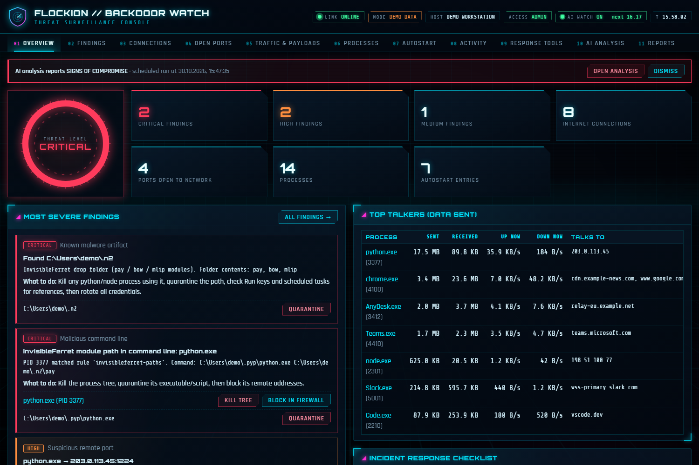
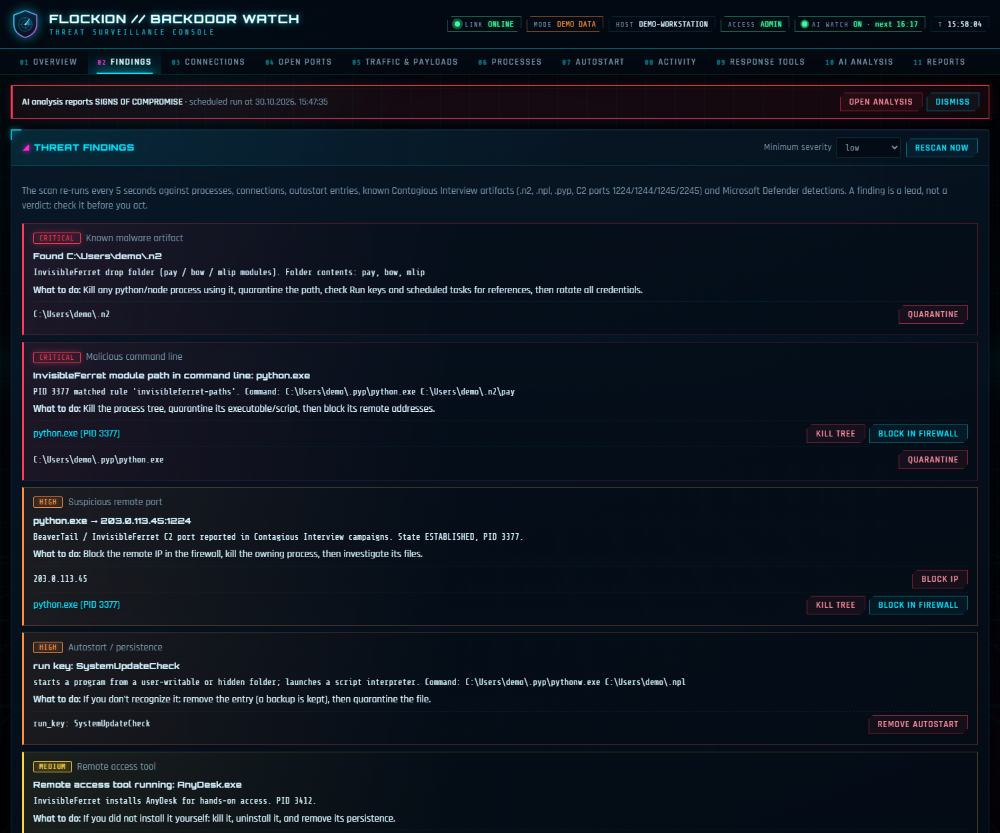
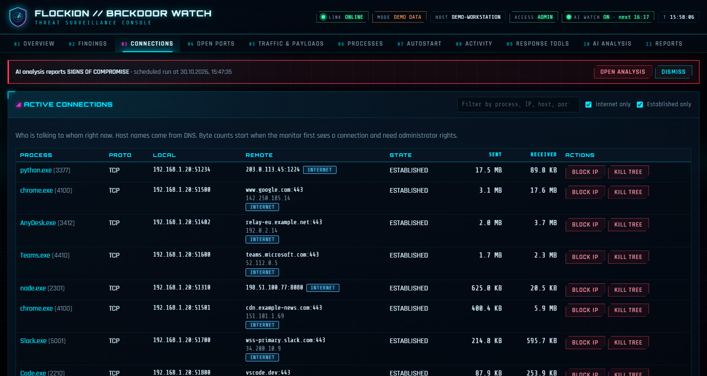
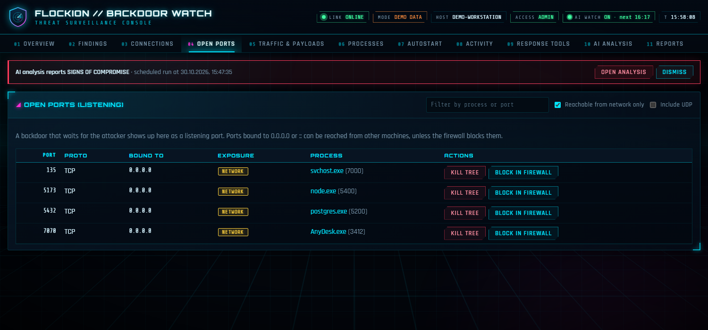
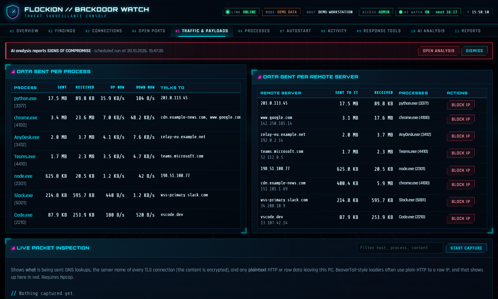
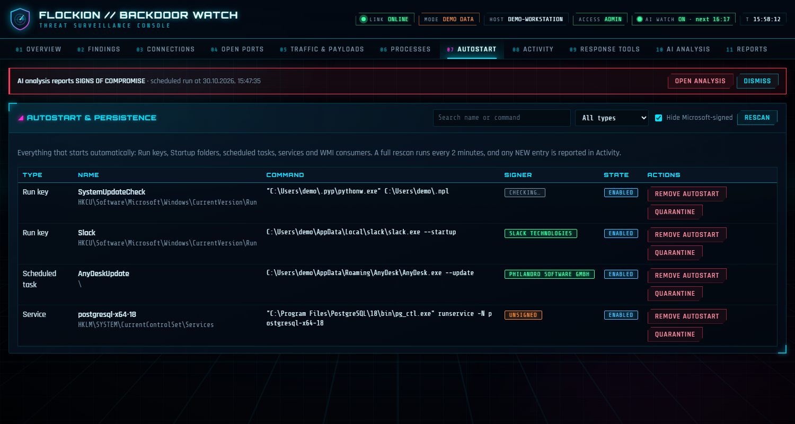
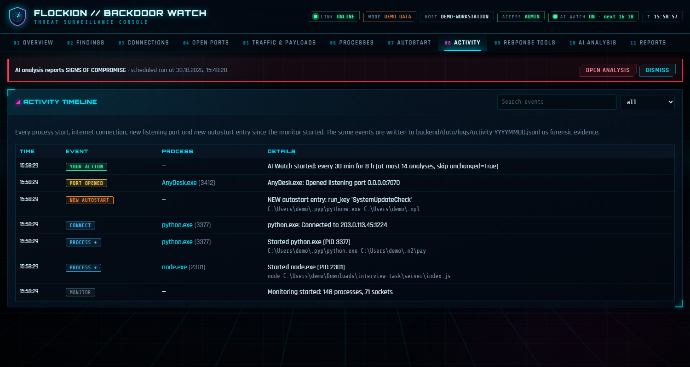
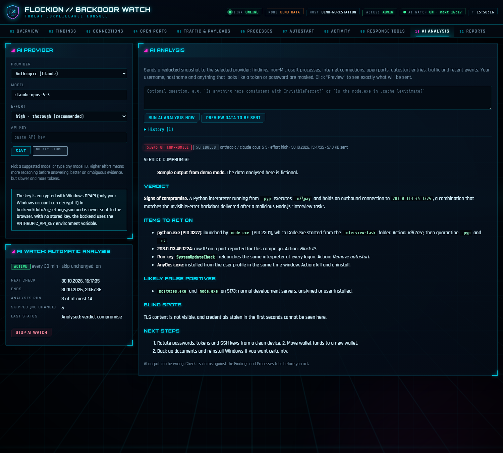
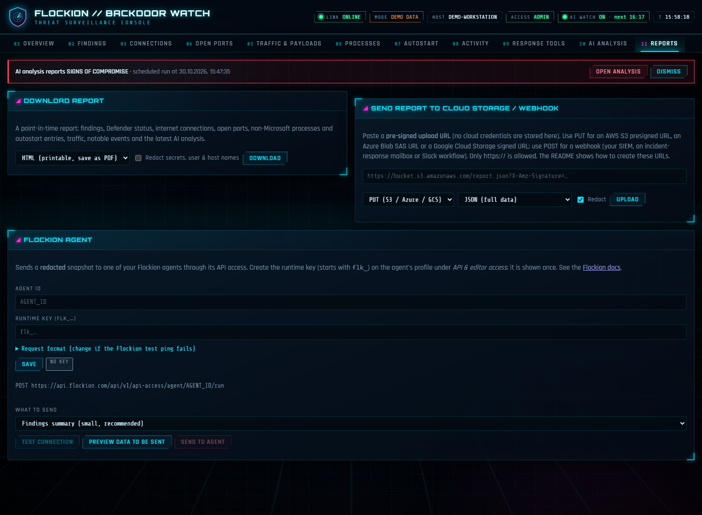

# User guide

Screenshots were taken in **demo mode** (`python run.py --demo`): fictional processes, documentation-range IP
addresses (`203.0.113.x`, `198.51.100.x`) and a made-up user.

## Contents

1. [Overview](#overview)
2. [Findings](#findings)
3. [Connections](#connections)
4. [Open ports](#open-ports)
5. [Traffic and payloads](#traffic-and-payloads)
6. [Autostart](#autostart)
7. [Activity](#activity)
8. [AI analysis and AI Watch](#ai-analysis-and-ai-watch)
9. [Reports and cloud upload](#reports-and-cloud-upload)
10. [Flockion](#flockion)
11. [Response tools](#response-tools)
12. [Where data is stored](#where-data-is-stored)
13. [Troubleshooting](#troubleshooting)

The monitor's own processes (the server, the window that ran `start.ps1`, its PowerShell helpers) carry a green
**Backdoor Watch** badge and are never reported as threats. Defender running in *passive mode* while another
antivirus (for example McAfee) is active is normal and shown as INFO.

## Overview

The threat gauge reflects the worst finding (info never raises it). Tiles count findings, internet connections,
ports reachable from the network, processes and autostart entries. Below: the most severe findings with action
buttons, the programs that sent the most data, and an incident-response checklist (rotate credentials, move wallet
funds, reinstall if critical).

## Findings

Re-evaluated every 5 seconds. Every finding names its evidence, what to do, and the targets you can act on:
**Kill tree**, **Block in firewall**, **Quarantine**, **Block IP**, **Remove autostart**. A finding is a lead, not a
verdict: check it before you act.

## Connections

Every TCP/UDP connection with the owning process, remote host name (from DNS), state, and bytes sent and
received (needs administrator rights; counting starts when the monitor first sees a connection). Filter by
process, IP, host or port; block an IP or kill the owner from the row.

## Open ports

Listening sockets. A backdoor waiting for its operator shows up here. "Reachable from network" marks sockets bound
to `0.0.0.0` or `::`.

## Traffic and payloads

Data sent per process and per remote server. With [Npcap](https://npcap.com) installed, **Live packet inspection**
shows DNS lookups, the server name in each TLS handshake (content stays encrypted), and any plaintext HTTP or raw
data leaving the PC, a typical BeaverTail trait.

## Autostart

Run keys, Startup folders, scheduled tasks, services and WMI consumers, with signature status. Microsoft-signed
entries are hidden by default. **Remove autostart** backs the entry up first.

## Activity

Timeline of process starts, internet connections, new listening ports, new autostart entries and your own actions,
also written to `backend/data/logs/activity-YYYYMMDD.jsonl` as evidence.

## AI analysis and AI Watch

1. Choose **Provider**, **Model** and **Effort**, paste the API key, **Save**. The key is encrypted with Windows
   DPAPI and never sent to the browser. Without a stored key the backend reads `ANTHROPIC_API_KEY` or
   `OPENAI_API_KEY`.
2. **Preview data to be sent** shows the exact redacted JSON (about 60 KB). **Run AI analysis now** sends it.

| Provider | Suggested models | Effort levels | Default |
| --- | --- | --- | --- |
| Anthropic | `claude-opus-5-5`, `claude-sonnet-5-5` (cheaper), `claude-haiku-5-5` (cheapest), `claude-fable-5-1` | `low` `medium` `high` `xhigh` `max` | `high` |
| OpenAI | `gpt-5`, `gpt-5-mini` | `minimal` `low` `medium` `high` | `medium` |

You can type any model ID. Effort is how much the model reasons before answering: `high` suits triage, `xhigh`/`max`
a deeper second look, `low` a quick check. On OpenAI it only works with reasoning models.

**What is sent:** findings, non-Microsoft processes, internet connections, open ports, autostart entries, traffic
totals, Defender status, notable events. Usernames, hostnames and anything that looks like a token or password are
masked first; the model is told to treat the data as untrusted.

### AI Watch (automatic analysis)

Check every 5 / 10 / 15 / 30 min or 1 / 2 / 6 / 12 h, for a number of hours or days (up to 30). The panel shows the
maximum number of analyses, which is your worst-case spend. Local monitoring (every 2 s) is free; only the
scheduled checks call the AI. Before each check a fingerprint of the security-relevant state (findings,
non-Microsoft programs, listeners, autostart entries, Defender detections) is compared with the last analysed
state, and **unchanged states are skipped**. Ordinary browser connections are excluded because they change every
second. It pauses itself after 3 failures in a row, runs one analysis at a time, resumes after a restart until its
end time, and keeps the last 50 analyses. A *compromise* or *suspicious* verdict shows a banner on every tab.

## Reports and cloud upload

**Download** HTML (print to PDF), Markdown or JSON, optionally redacted. **Upload** with a pre-signed URL; no cloud
credentials are stored, only `https://` is accepted, and the audit log records the destination host only.

| Destination | Method | Create the URL |
| --- | --- | --- |
| AWS S3 | PUT | `python -c "import boto3; print(boto3.client('s3').generate_presigned_url('put_object', Params={'Bucket':'my-bucket','Key':'reports/pc.json'}, ExpiresIn=3600))"` |
| Azure Blob | PUT | `az storage blob generate-sas --account-name ACCOUNT --container-name reports --name pc.json --permissions cw --expiry 2026-12-31T00:00Z --https-only --full-uri --auth-mode login --as-user` |
| Google Cloud Storage | PUT | `gcloud storage sign-url gs://my-bucket/reports/pc.json --http-verb=PUT --duration=1h --private-key-file=key.json` |
| Webhook (SIEM, Slack workflow, n8n…) | POST | the webhook URL |

## Flockion

[Flockion](https://flockion.com) agents (including those you use through its VS Code extension) can be run through
API access. This tool can hand one a redacted snapshot.

1. In Flockion open the agent profile → **API & editor access** and create a runtime key. It starts with `flk_`, is
   shown once, and has an expiry and daily call limit that you set. It is not a model-provider key.
2. In **Reports → Flockion agent** enter the **Agent ID** and the key, then **Save**.
3. **Test connection** sends a short ping with no system data. Check the status code and response shown.
4. Choose **Findings summary** (small) or **Full snapshot**, use **Preview data to be sent**, then **Send to agent**.

The endpoint is `POST https://api.flockion.com/api/v1/api-access/agent/AGENT_ID/run`. The public Flockion
documentation covers the URL and the key format but not the authentication header, the request body or the
response, so those are editable under *Request format*. Defaults: header `Authorization` with scheme `Bearer`, and
a JSON body `{"message": "<text>"}`. If you see HTTP 401/403 or a validation error, change those to what your
agent's API & editor access page specifies. If you get an HTML page, you are calling the website
(`flockion.com`) instead of the API host. "Runtime admission denied" usually means the key expired, hit its daily
limit, or the account or provider connection lacks capacity.

## Response tools

Defender (status, **Turn on real-time protection**, **Open Windows Security**, scans), firewall blocks created by
this tool (listed and removable), quarantine (restore, or delete forever), and a static **code-folder scan** for
loader and stealer patterns (including **Sweep all my code folders**). Turning on real-time protection only works
when Defender is the active antivirus and Tamper Protection allows it.

## Where data is stored

| Path | Contents |
| --- | --- |
| `backend/data/logs/activity-YYYYMMDD.jsonl` | Timeline and audit trail |
| `backend/data/quarantine/` | Quarantined files (no extension) and manifests with SHA-256 |
| `backend/data/backups/` | Backups of removed autostart entries |
| `backend/data/ai_settings.json`, `flockion_settings.json` | Provider choices and DPAPI-encrypted keys |
| `backend/data/ai_schedule.json`, `ai_history.jsonl` | AI Watch schedule and the last 50 analyses |

## Troubleshooting

| Symptom | Fix |
| --- | --- |
| "Missing or expired session token" | Open the exact URL printed in the console; the token changes on every start |
| Header shows "LIMITED (not admin)" | Start with `start.ps1` or from an administrator PowerShell |
| Byte counts show "—" | Needs administrator; counting starts when a connection is first seen |
| "Npcap is not installed" | Install Npcap from <https://npcap.com> and restart |
| AI: "rejected the API key" | Re-enter the key and check billing in the provider's console |
| Flockion test returns 401/403/422 | Adjust header, scheme or body field under *Request format* |
| Port 8765 in use | `run.py --port 9000` (and update `vite.config.ts` in dev mode) |
| Demo shows "actions are disabled" | Intended: demo mode is read-only |
